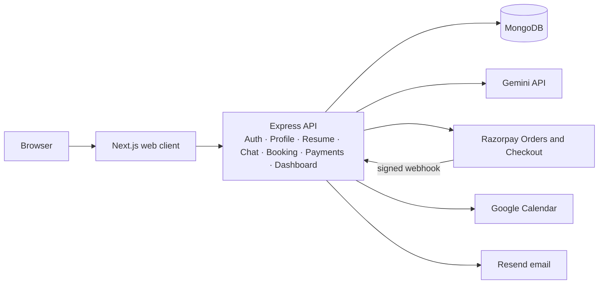

# ThrivePath

ThrivePath is a career workspace for personal profiles, resume editing, AI career conversations, and paid career consultations. The repository is split into a Next.js client and an Express/MongoDB API.

## Architecture

The current deployment is a **modular monolith with microservice-oriented boundaries**, not separately deployed microservices. This is a deliberate scope trade-off: one API process and one MongoDB deployment keep local setup and transactional booking manageable, while the bounded contexts can be extracted later. The client currently calls the Express API directly; there is no separate API gateway:

- **Identity and profile** owns registration, login cookies, authorization, and career profile data.
- **Resume** owns structured resume content, template selection, editing, search, and previews.
- **Career coach** owns conversations and messages, applies rate limits, and calls the configured LLM from the server.
- **Consultations and payments** owns consultant availability, booking state, Razorpay Orders, Checkout verification, and webhook processing.
- **Notifications and calendar** run after a verified successful Razorpay payment and record integration outcomes on the booking.
- **Dashboard** is a read-only aggregation over the user's resumes, chat sessions, and bookings.

The Next.js application calls the Express API over JSON/HTTP. The API uses domain routes, controllers, services, and Mongoose models rather than allowing the frontend to access MongoDB or third-party secrets. Payment webhooks use a separate raw-body route because signature validation must use the original request bytes. Calendar and email work is initiated only after payment verification; deterministic Calendar event IDs and persisted integration statuses reduce duplicate side effects.

MongoDB is the primary store. User-owned resumes, chat sessions, and bookings reference the user rather than duplicating account data. Chat messages reference both the session and owner and are indexed in chronological session order. Resume and booking lists paginate on the server. A partial unique consultant/time index prevents active bookings from colliding while allowing cancelled or failed slots to be booked again. Dashboard values use indexed count queries plus a small, sorted query for the next upcoming consultation; no cache is used because this initial deployment prioritizes correctness and has low-cost indexed reads.

The web client and API can be deployed separately. The API can later be split by the bounded contexts above; the current MongoDB schemas and HTTP boundaries avoid a premature distributed deployment. Configure the frontend's allowed origin and the API's `CLIENT_URL` to the deployed client URL. Use TLS, a managed MongoDB deployment, production secrets, and a Razorpay webhook endpoint at `/api/payments/razorpay/webhook`.

## Implemented workflows

- Registration, login, logout, protected profile read/update, and role-aware authentication middleware.
- Profile completion and a personalized dashboard with live resume, chat, and consultation counts.
- Structured resume CRUD, server-side search/pagination/sorting, validated AI-generated drafts, a Tiptap summary editor, two templates, semantic preview, and browser print-to-PDF.
- Persistent career-coach sessions and messages, session rename/delete, bounded conversation context, provider timeout/error handling, and AI endpoint IP rate limits.
- Consultant availability lookup, future-slot validation, active slot collision protection, Razorpay Checkout, server-side payment signature and capture checks, webhook signature validation, Google Calendar meeting creation, and email confirmation through Resend.
- Booking listing filters and pagination are enforced by the API; a booking is confirmed only after the server verifies payment with Razorpay.
- OpenAPI details for the implemented routes are in [backend/openapi.yaml](./backend/openapi.yaml).

## Local setup

Prerequisites: Node.js 20+ and MongoDB 6+ (a local server or Atlas URI).

1. Run `npm install` in both `backend` and `frontend`.
2. Copy `backend/.env.example` to `backend/.env`; set `MONGODB_URI`, a strong `JWT_ACCESS_SECRET`, and `CLIENT_URL`.
3. Copy `frontend/.env.example` to `frontend/.env.local`.
4. Start MongoDB, then run `npm run dev` in `backend` and `npm run dev` in `frontend`.
5. Optionally run `npm run seed:consultants` in `backend` to add clearly fictional local demo consultants. This command is explicit and is never run automatically.

The API listens on port `4000` with the provided backend environment example; the web client runs on port `3000`.

### Optional integrations

Set these only when using the matching workflow. Without them the relevant backend route reports a configuration error rather than returning fake success.

- **LLM:** `GEMINI_API_KEY`, `LLM_MODEL`, optional comma-separated `LLM_FALLBACK_MODELS`, and `LLM_TIMEOUT_MS`. Keys remain on the backend.
- **Razorpay:** `RAZORPAY_KEY_ID`, `RAZORPAY_KEY_SECRET`, and (for asynchronous payment confirmation) `RAZORPAY_WEBHOOK_SECRET`. Configure the webhook URL as `/api/payments/razorpay/webhook` and subscribe to `payment.captured`. Checkout orders are created server-side and payment signatures are verified on the server before confirming a booking.
- **Google Calendar:** `GOOGLE_CLIENT_ID`, `GOOGLE_CLIENT_SECRET`, `GOOGLE_REFRESH_TOKEN`, and optionally `GOOGLE_CALENDAR_ID`. The OAuth account needs calendar event creation access.
- **Email:** `EMAIL_API_KEY` (Resend API key) and `EMAIL_FROM` (verified sender address).

`backend/.env.example` also lists the optional SMTP values retained for future mail-provider substitution; the current confirmation implementation uses Resend's HTTPS API.

## ATS and resume output

Resume content is stored as structured fields, independently of the selected presentation. Both templates render semantic HTML with a single `h1`, section `h2` headings, text-based contact details, and ordinary lists/paragraphs. The ATS Classic template avoids graphics and multi-column layout; both templates keep text selectable and machine-readable. The browser's print dialog can save the preview as PDF. Tiptap summary content is saved as plain text to keep the persisted resume and preview safe and portable.

## Operational notes

- The access token is stored in an `httpOnly`, `sameSite=lax` cookie. Use HTTPS in production and configure CORS to a single trusted client origin.
- Keep secrets out of the frontend environment. `NEXT_PUBLIC_API_URL` is the only client setting.
- Booking confirmation is driven by server-side Razorpay verification and can also be completed by the signed webhook.
- Google Calendar or email outages leave explicit integration statuses on a confirmed booking. Event, message, booking, and user ownership is checked server-side.
- No Redis cache or token refresh flow is enabled in this version. Add those only after deployment traffic and session-lifetime requirements are understood.

## Known limitations and scaling

- This is one deployable API process with modular service boundaries, rather than independently deployed microservices or a separate API gateway. The trade-off is simpler local setup and booking/payment transactions; extracting services later would require service authentication, distributed tracing, and explicit event delivery.
- There is no automated test suite yet. The Jest command is configured, but currently reports that no tests were found. This leaves the assignment's requested auth, resume, chat, booking, and webhook coverage outstanding.
- Refresh tokens, password reset, email verification, streaming chat, resume versioning, Redis, Docker Compose, and production observability are not implemented. Calendar, email, and Razorpay require their own credentials before those integrations can run end to end.
- To scale toward one million users, deploy stateless API instances behind a load balancer, move LLM calls and post-payment notifications to queued workers, add service-level auth and tracing, and use Redis for short-lived read caching and distributed rate limits. Review MongoDB query plans and compound indexes under load; shard only after measured write/read pressure justifies the operational cost. Keep payment event processing and booking-slot uniqueness idempotent across workers.

## Tests and checks

Backend tests are intended to run with `npm test` in `backend`; frontend static checks and production compilation use `npm run lint` and `npm run build` in `frontend`. The backend currently has no test files, so passing Jest with `--passWithNoTests` is not evidence of workflow coverage.
